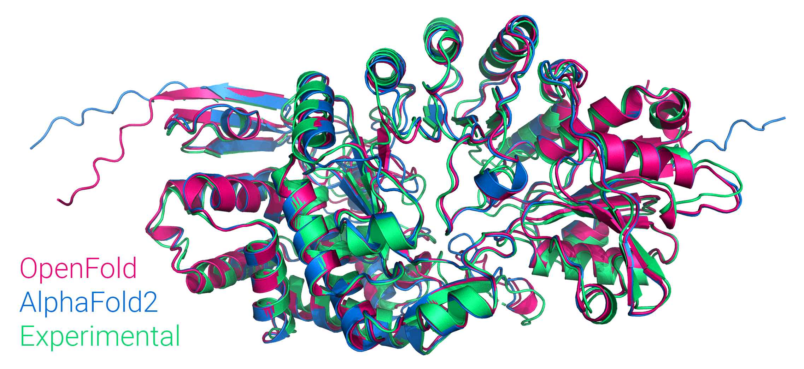

<<<<<<< HEAD
# 「富岳」実装版OpenFold (OpenFold for Fugaku)
=======

_Figure: Comparison of OpenFold and AlphaFold2 predictions to the experimental structure of PDB 7KDX, chain B._
>>>>>>> e938c184

## ソースコードと必要ファイルの取得

<<<<<<< HEAD
「富岳」実装版OpenFoldのソースコードをクローンする
```shell
git clone https://github.com/RIKEN-RCCS/OpenFold-for-Fugaku.git
cd OpenFold-for-Fugaku
```

`openfold/resources/`ディレクトリに`stereo_chemical_props.txt`をダウンロードする
```shell
wget -P openfold/resources https://git.scicore.unibas.ch/schwede/openstructure/-/raw/7102c63615b64735c4941278d92b554ec94415f8/modules/mol/alg/src/stereo_chemical_props.txt
```

## データセットの取得
データセットを保存する任意のディレクトリ(以降`DATADIR`と記載)を用意しておく。
aria2をインストールしたのち、学習済みモデルおよび推論や学習に必要なデータセットをダウンロードする。

```shell
git clone https://github.com/spack/spack.git
SPACK_ROOT=`pwd`/spack
source $SPACK_ROOT/share/spack/setup-env.sh
spack install aria2
spack load aria2

DATADIR="データセットを保存するディレクトリ"
bash scripts/download_alphafold_params.sh $DATADIR
bash scripts/download_alphafold_dbs.sh $DATADIR reduced_dbs
```

## 初期設定
`scripts/setenv`の以下の環境変数を設定する

- `PREFIX`: インストールディレクトリ (必須)
- `OPENFOLDDIR`: このREADME.mdがあるディレクトリ (必須) 
- `DATADIR`: データセットをダウンロードしたディレクトリ (必須)
- `PJSUB_OPT`: ジョブ投入時の追加オプション (任意)
    - シングルアカウントの場合は`-g <グループID>`を指定する
    - 必要におうじて`-x PJM_LLIO_GFSCACHE=<ボリューム>`を指定する

## インストール
インストールジョブを投入するスクリプトを実行する
```
./scripts/install_fugaku.sh
```
ジョブの出力は`install_openfold.*_0.out`と`install_openfold.*_1.out`に書き込まれます。ジョブの終了後、それらのファイルの最後に`Finished`が出力されていることを確認してください。


## 推論
### 対象配列が少数である場合
inferenceディレクトリのシングルノード版スクリプトで前処理と推論を連続して行います。詳細は[こちら](inference/README.md)

### 対象配列が多数である場合
1. preproc_fugakuディレクトリのマルチノード版スクリプトで前処理を行います。詳細は[こちら](preproc_fugaku/README.md)
2. inferenceディレクトリのスクリプトで推論を行います。詳細は[こちら](inference/README.md)

## Copyright notice
Copyright 2023 RIKEN & Fujitsu Limited
=======
A faithful but trainable PyTorch reproduction of DeepMind's 
[AlphaFold 2](https://github.com/deepmind/alphafold).

# Documentation
See our new home for docs at [openfold.readthedocs.io](https://openfold.readthedocs.io/en/latest/), with instructions for installation and model inference/training.

Much of the content from this page may be found [here.](https://github.com/aqlaboratory/openfold/blob/main/docs/source/original_readme.md)

## Copyright Notice
>>>>>>> e938c184

This software includes AlphaFold and OpenFold that are distributed in the Apache License 2.0.
However, DeepMind's pretrained parameters fall under the CC BY 4.0 license, a copy of which is downloaded to `openfold/resources/params` by the installation script. Note that the latter replaces the original, more restrictive CC BY-NC 4.0 license as of January 2022.

<<<<<<< HEAD
## Changes from the original OpenFold
- Add code to preprocess multiple sequences using multiple nodes in Fugaku
- Add code to infer multiple sequences using multiple nodes in Fugaku
- Port the memory-efficient attention module to CPUs
- Improve processing efficiency of batch matrix multiplications (BMMs) by making the input tensors to BMMs contiguous
- Speed up reading of mmcif data by pickling and lz4 compression beforehand
=======
## Contributing

If you encounter problems using OpenFold, feel free to create an issue! We also
welcome pull requests from the community.

## Citing this Work

Please cite our paper:

```bibtex
@article {Ahdritz2022.11.20.517210,
	author = {Ahdritz, Gustaf and Bouatta, Nazim and Floristean, Christina and Kadyan, Sachin and Xia, Qinghui and Gerecke, William and O{\textquoteright}Donnell, Timothy J and Berenberg, Daniel and Fisk, Ian and Zanichelli, Niccolò and Zhang, Bo and Nowaczynski, Arkadiusz and Wang, Bei and Stepniewska-Dziubinska, Marta M and Zhang, Shang and Ojewole, Adegoke and Guney, Murat Efe and Biderman, Stella and Watkins, Andrew M and Ra, Stephen and Lorenzo, Pablo Ribalta and Nivon, Lucas and Weitzner, Brian and Ban, Yih-En Andrew and Sorger, Peter K and Mostaque, Emad and Zhang, Zhao and Bonneau, Richard and AlQuraishi, Mohammed},
	title = {{O}pen{F}old: {R}etraining {A}lpha{F}old2 yields new insights into its learning mechanisms and capacity for generalization},
	elocation-id = {2022.11.20.517210},
	year = {2022},
	doi = {10.1101/2022.11.20.517210},
	publisher = {Cold Spring Harbor Laboratory},
	URL = {https://www.biorxiv.org/content/10.1101/2022.11.20.517210},
	eprint = {https://www.biorxiv.org/content/early/2022/11/22/2022.11.20.517210.full.pdf},
	journal = {bioRxiv}
}
```
If you use OpenProteinSet, please also cite:

```bibtex
@misc{ahdritz2023openproteinset,
      title={{O}pen{P}rotein{S}et: {T}raining data for structural biology at scale}, 
      author={Gustaf Ahdritz and Nazim Bouatta and Sachin Kadyan and Lukas Jarosch and Daniel Berenberg and Ian Fisk and Andrew M. Watkins and Stephen Ra and Richard Bonneau and Mohammed AlQuraishi},
      year={2023},
      eprint={2308.05326},
      archivePrefix={arXiv},
      primaryClass={q-bio.BM}
}
```
Any work that cites OpenFold should also cite [AlphaFold](https://www.nature.com/articles/s41586-021-03819-2) and [AlphaFold-Multimer](https://www.biorxiv.org/content/10.1101/2021.10.04.463034v1) if applicable.
>>>>>>> e938c184
